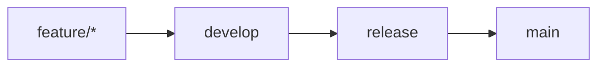
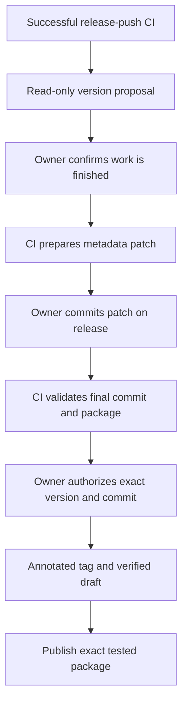

# How CI and releases will work

The plan keeps Rustcorder as one native Rust application. GitHub Actions will
validate changes, calculate versions and prepare release evidence. New Node
tools are confined to CI; the installed application gains no Node/Python runtime
dependency or network requirement.

The complete [implementation plan](../specs/003-ci-quality-release/plan.md),
[research](../specs/003-ci-quality-release/research.md) and
[validation guide](../specs/003-ci-quality-release/quickstart.md) contain the
technical contracts. The [Avo reference](ci-quality-release-reference.md)
explains the starting comparison.

## Normal development

Feature pushes and each proposed promotion run required checks. Release pushes
also produce the actual package evidence. Main receives the already published
version; merging there does not bump or publish again.

| Check group | What it proves |
| --- | --- |
| CI policy | Valid workflow, permitted promotion, conventional change classification and tested CI helpers |
| Rust checks | Formatting, static analysis, supported build, unit and boundary tests |
| Quality | Measured coverage, complexity, unused code, duplication and dependency/source/license policy |
| UI | Both screens retain visible controls, correct enabled states and keyboard actions |
| Mutation | Tests actually detect faults in Rust and CI/release decisions |
| Package smoke | Verified portable bytes launch, navigate and close on a real desktop |
| Readiness/report | Every required check succeeded and measurements belong to this exact attempt |

Existing build/package entry points stay in use. The baseline will be measured
before it is enforced: coverage gets its own positive floor, never Avo's copied
68%. Initial policy is function complexity at most 10 with reviewed exact debt,
duplication at most 2%, and mutation floors 40% light / 50% full.

An expired/stale exception, absent measurement or failed scanner cannot look
green. Reports distinguish passed, failed, incomplete, excluded and advisory.
Ordinary evidence remains available for at least 14 days.

## Desktop tests

Fast checks reuse the actual egui drawing fixtures and add a matching
development-only accessibility test harness. They exercise both tabs across six
state families, three window sizes and two display scales. The lost-Cancel
regression and keyboard navigation get explicit failing-first tests.

Before release, a separate smoke test launches the real package with isolated
settings, navigates both screens and closes normally. It captures diagnostics
without recording audio or loading a large model. Missing desktop capability
fails; a simulation cannot substitute for a successful native launch.

We will first try a disposable hosted Windows runner with a strict capability
check. If it cannot provide the required desktop, the release lane needs a
trusted disposable interactive runner. Hosted Windows Server success remains
separate from clean Windows 11 and real microphone/call acceptance.

## Versioning and publication

This preserves the repository's user-owned branches and separate release
authorization rules. CI calculates/prepares everything; it does not create
branches, merge them or push version commits. Metadata synchronization back to
develop uses user-controlled feature work under the normal promotion policy.

Version calculation uses official semantic-release analysis/notes components.
Compatible fixes and release-documentation corrections produce PATCH, compatible
features MINOR and breaking changes MAJOR. Ordinary non-release changes produce
no version. The first release requires explicit bootstrap confirmation.

We will not invoke stock semantic-release's publishing pipeline because its
[tag implementation](https://github.com/semantic-release/semantic-release/blob/master/lib/git.js)
creates lightweight tags. A small approved publisher creates the required
annotated tag, stages the matching draft/package/evidence, verifies attachments
and publishes. Published tags and conflicting asset bytes are never overwritten.

Every release binds the final commit, preparation patch, successful CI run and
rerun attempt, artifact identities and checksums. Changing the candidate after
approval invalidates it. Earlier checks cannot certify a later version commit.

## Implementation order

1. Add failing-first tests for policy, evidence parsing and version rules, then
   connect the existing Rust checks and reproducible Windows setup.
2. Measure coverage/debt and add blocking quality checks and readable reports.
3. Extend desktop tests and run both mutation engines, with a small light scope
   on contributions and broader weekly/manual checks.
4. Add version/package identity and actual native smoke.
5. Implement and fixture-test preparation, approval, publication and safe retry.
6. Verify hosted required checks/approval settings and the measured runtime budget.

Targets are 45 minutes for the ordinary warm-cache path, 20 minutes per light
mutation engine and 60 minutes per full engine. All four local mutation profiles
pass their engine budgets; the hosted critical path and three warm attempts remain
unmeasured. Full mutation is scheduled for Mondays at 06:00 UTC,
03:00 America/Sao_Paulo.

## Current state and completion limits

Read-only GitHub inspection on 2026-11-05 found only main, no remote tags or
release environments, no rulesets and no protection on main. Default workflow
permissions are already read-only. The user will establish develop/release and
configure required checks and release approval; implementation must verify the
settings actually block unsafe promotion/publication.

The implementation now installs the three workflows and their pinned support
tools. Local Rust quality gates, UI draw/input tests and a packaged Debug native
smoke have real passing evidence. Mutation/package/release evidence and remaining
hosted adoption are tracked in [validation](ci-quality-release-validation.md).
No product version, changelog release entry, branch/ref or remote release was
changed. Existing staged UI work is preserved; additions cover its CI tests.

The reproducible commands and exact policy limits are in
[development](development.md#reproducing-ci-locally). The owner-facing required
checks and reviewer setup are in [branching](branching.md); confirmed preparation,
approval comment, bootstrap, synchronization and retry behavior are in
[versioning](versioning.md). These files describe implemented behavior; remote
enforcement, hosted desktop capability and three complete warm-run timings remain
acceptance work until verified.

Publication checks both configured reviewers and the actual workflow review
history. At least one explicit user reviewer is supported, including owner
self-review; team-only rules are refused. The review comment identifies the
candidate digest, run and attempt, preventing an older approval from authorizing a
new attempt. Sources: [environment rules](https://docs.github.com/en/rest/deployments/environments),
[workflow review history](https://docs.github.com/en/rest/actions/workflow-runs#get-the-review-history-for-a-workflow-run).
