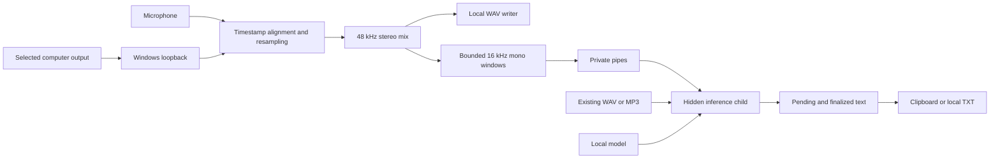

# Local desktop technical plan

Date: 2026-11-02. Proposed design; the app has not been implemented or benchmarked.
[Feature specification](../specs/001-record-transcribe/spec.md) ·
[Execution plan](../specs/001-record-transcribe/plan.md) ·
[Research sources and versions](../specs/001-record-transcribe/research.md).

## Recommended implementation

| Part | Choice | Purpose |
| --- | --- | --- |
| Desktop UI | Rust egui/eframe | Native window, no browser frontend |
| File/folder selection | rfd | Native local dialogs |
| Audio capture | wasapi | Microphone and Windows output loopback |
| Audio synchronization | Timestamped buffers + rubato | Align independent device clocks/rates |
| Audio files | hound + Symphonia | Stream WAV; import WAV/MP3 locally |
| Speech recognition | whisper-rs + whisper.cpp | Local model inference on CPU |
| Isolation | Hidden child of the same executable | Native inference failure cannot kill recording |
| Persistence | Local JSON and UTF-8 TXT | Settings and text without a database |

These choices come from current primary documentation, not a tested compatible
lockfile. Rust manages the app; whisper.cpp is a native C/C++ dependency through
Rust bindings. End users need no Python, AI server, API keys or installed Whisper CLI.

## UI

One window with **Record** and **Transcribe file**, plus shared model settings.
Initial UI labels can be English; the spoken-language selector is independent.

**Record:** mode (microphone / microphone + computer), microphone selector,
computer-output selector for combined mode, save folder, live-transcription toggle,
language/model readiness, Start/Stop, elapsed time and saved-file result. Show a
simple level indicator to help detect a wrong input; no waveform editor is required.
The transcript panel distinguishes finalized text from a revisable tail and offers
Copy and Save text. Recording and transcript-finalization statuses remain separate.
After audio is saved, Start stays unavailable until the previous transcription
finishes or is cancelled; saving audio alone does not free the transcription slot.

**Transcribe file:** WAV/MP3 picker, language/model, Transcribe/Cancel, processing
status and the same transcript panel. Reject conflicting task starts without
disrupting the current task; do not introduce a background-job queue.

**Models:** local folder picker, compatible model list, supported languages and
validation status. Portuguese is the default. Missing models block transcription
but never plain recording. Configuration changes are disabled while busy. Scan/load
off the UI thread, and retain the selected folder/model/language across restarts.

Use visible labels, keyboard focus, text plus color for states, and copyable errors.
Enable AccessKit and verify Windows Narrator/scaling; a custom-drawn UI is not
automatically accessible. The UI framework supports native rendering and accessibility
features: [eframe documentation](https://docs.rs/eframe/0.37.0/eframe/).

## Actions and integrations

| Action | What runs locally | Result |
| --- | --- | --- |
| Select mic/output | Enumerate Windows audio endpoints | Device IDs/names and availability |
| Start microphone recording | Open mic, validate folder, start writer | Active state and timer |
| Start microphone + computer | Mic plus selected output loopback | Both sources captured together |
| Stop | End capture, drain writer, finalize WAV | Saved audio independently of pending text |
| Select model folder | Validate compatible local weights in child | Ready models/languages or error |
| Transcribe file | Decode audio, convert to mono, infer in child | Progress and corresponding-language text |
| Transcribe live | Send bounded audio windows to child | Pending then finalized text |
| Copy/save | Clipboard or new local UTF-8 file | Text retained if save fails |

Meet and Discord need **no direct integrations**: Windows loopback captures what
plays through the selected output device. The call must use that output. Other apps'
sounds and notifications on it are included. No bot, OAuth, plugin or virtual audio
cable is needed. Headphones are the test baseline; speaker echo cancellation and
protected-content capture are not promised.
[Microsoft loopback contract](https://learn.microsoft.com/en-us/windows/win32/coreaudio/loopback-recording).

## Audio pipeline



Capture threads own initialized COM/audio clients, copy timestamped packets, release
them promptly and enqueue without blocking. A mixer/writer consumes separate bounded
queues. Recording never waits for recognition. Capture/writer overflow becomes a
visible interrupted result; inference overload only makes text lagging/incomplete.

Align sources on a common performance-counter timeline, correct start offsets and
gradual clock drift, and resample differing device rates. Arrival order alone is not
adequate synchronization. Quiet healthy output advances with silence; device loss
and discontinuities are separate errors. Prove silent output, mixed sample rates
and one-hour drift on actual devices before polishing the UI.

Save 48 kHz stereo 16-bit PCM WAV. Mix the mono mic into both output channels with
conservative fixed gain (initially 0.5 per source), clamp and convert; do not monitor
the mix back into the computer output. Mic-only can use the same format. One hour
is 691,200,000 bytes of payload, about 659 MiB. Stream to disk rather than retaining
the hour in RAM. Standard RIFF WAV has a size limit: propose a disclosed six-hour
per-recording cap with controlled stop/save before overflow. It exceeds the specified
one-hour acceptance duration, but is a product limit to review before implementation.

## Model folder

Support these whisper.cpp-compatible GGML files directly inside the chosen folder:

```text
ggml-base.bin          # multilingual: Portuguese and English
ggml-small.bin         # multilingual accuracy candidate
ggml-base.en.bin       # optional English-only
ggml-small.en.bin      # optional English-only
```

The user does not need all four. One valid multilingual model can serve both
languages. Filenames identify candidates, but actual metadata/native loading
determine compatibility; a renamed English-only model must not enable Portuguese.
Arbitrary GGUF, ONNX, quantized files and model-folder formats are not promised.

Users acquire weights separately and copy them locally, including by removable
storage for an offline computer. No in-app downloader is planned. See the
[model provisioning guide](../specs/001-record-transcribe/quickstart.md).
Model files remain user-owned/read-only; settings save paths, not duplicate weights.

The Brazilian Portuguese option maps to Whisper's `pt`, not a separate dialect
model. English maps to `en`; disable translation and automatic language detection.
Base is about 142 MiB and small about 466 MiB; total RAM and speed differ from file
size. Benchmark Brazilian speech rather than assuming a generic Portuguese model
meets the accuracy target. [Official model guide](https://github.com/ggml-org/whisper.cpp/blob/master/models/README.md).

## Live text and failure isolation

Whisper requires incremental processing logic; it is not turnkey guaranteed live
transcription. Begin with overlapping eight-second windows updated every two seconds
as a tuning candidate. Keep a revisable tail and commit stable timestamped passages
once. Compare time and token overlap without removing genuinely repeated phrases.
Flush only the retained tail at Stop, bounded by the specified finalization deadline.

Start with tested silence gating. If it fails quiet-speech/no-speech fixtures, an
explicit extra local VAD asset may be necessary; it must not appear as an implicit
download. Never claim a silence threshold prevents every transcription hallucination.

Retain one in-flight request and one latest pending window. If newer windows no
longer cover an untranscribed interval, mark the result incomplete; never silently
drop audio or claim the text is complete. The saved WAV remains available for retry.

The parent owns the window/audio writer and launches the same executable in hidden
inference mode, using private pipes rather than HTTP or a localhost port. Only the
child calls native model/inference functions. Child crash, cancellation or timeout
cannot close the parent-owned WAV; parent retains finalized text. A Rust background
thread alone cannot provide that native-crash isolation.

## What “100% local” means

Settings stay under `%LOCALAPPDATA%/rustcorder/settings.json`; recordings and text
stay in the selected folders. No database, telemetry, updater, online activation,
remote fonts/content, cloud inference or network service is part of runtime design.
The package must include its required native runtime files; verify first launch
on a clean disconnected Windows machine, not only the development computer.

Preparing builds/dependencies/models may require downloads. That does not create a
runtime network requirement; an air-gapped build would require cached build inputs
as a separate setup. Test offline capture using local played audio: Meet/Discord
themselves need networking, even though this recorder does not. Also trace the app's
processes in a connected test to prove they do not attempt network requests.

## Main feasibility gate

First compare base versus small on declared CPU/RAM and Portuguese/English reference
audio. Test <=20% clean-speech word error rate, <=5 s live phrase latency, real-time
file throughput and <=30 s finalization while recording. No benchmark was run here.
If neither model meets speed and accuracy, present the measured tradeoff before
changing targets; do not introduce a cloud fallback. Then prove timestamped capture,
one-hour drift and child-crash survival before expanding the UI.
