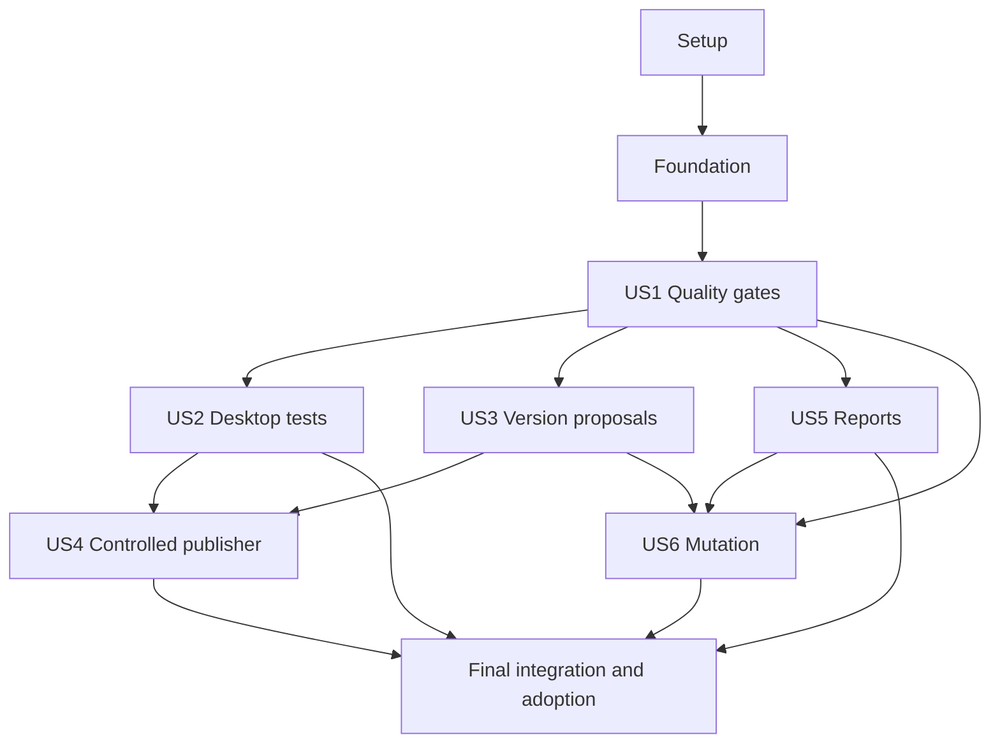

# Tasks: CI Quality Gates and Controlled Semantic Releases

**Input**: Design documents under `specs/003-ci-quality-release/`
**Branch**: `main`
**Created**: 2026-11-05
**Prerequisites**: [plan](plan.md), [specification](spec.md),
[research](research.md), [data model](data-model.md),
[CI evidence contract](contracts/ci-evidence.md),
[release contract](contracts/release.md), [validation guide](quickstart.md).

**Organization**: Six user-story phases in specification priority order, with
shared setup/foundation and a final integration/adoption phase. The checkboxes track implementation; task generation did not authorize publication.

## Format and execution rules

- Each task is `- [ ] Tnnn [P?] [USn?] description` with exact repository-relative
  file paths and explicit prerequisite IDs.
- `[P]` identifies disjoint work that can run concurrently after its prerequisites
  and the current phase's common gate are complete. It does not authorize branch
  operations or automatically dispatch agents.
- Tests come first for executable changes: capture a meaningful failing assertion,
  implement the smallest behavior, then rerun focused checks. Missing tools,
  import errors or absent private assets are setup failures, not regression proof.
- For behavior already correct, deliberately seeded faults must demonstrate the
  new check detects the regression; restore the fixture/product before completion.
- Preserve all existing tests and staged UI/layout work. Keep current application
  modules, offline runtime and private model/audio boundaries intact.
- Use RTK for shell commands and the existing Windows environment runner. Write
  explanatory/validation evidence directly under `docs/`; keep generated feature
  artifacts here.
- Temporary Git objects, release records and mocked APIs used by tests must be
  isolated from this repository's branch/tag refs and real publication remote.
- Foundation is mandatory before story work. Components can be proven with
  complete synthetic contract evidence; partial hosted readiness must remain
  blocked until the real report, mutation and applicable package lanes exist.
- Actual version/changelog updates still require completion confirmation;
  product tagging/publication requires separate authorization for the final
  commit/version/evidence. No task authorizes a real release by itself.

## Path conventions

Product code remains in `src/` and existing `tests/`. New CI support belongs in
`scripts/ci/`; workflow definitions in `.github/workflows/`. Configuration files
named in tasks are implementation outputs, not claims they already exist.
Use `docs/ci-quality-release-validation.md` for measured evidence and limits.

## Phase 1: Setup (shared infrastructure)

Establish the current-branch baseline and a private CI tool package. No product version, release entry or remote setting changes.

### Setup tasks

- [X] T001 Record the current branch, dirty-file hashes, existing format/Clippy/test results and ignored external cases; preserve staged UI work and the separate speaker feature in `docs/ci-quality-release-validation.md`.
- [X] T002 Create small valid/invalid event, receipt and analyzer samples plus isolated-repository conventions; keep private audio/model data out of fixtures in `scripts/ci/tests/fixtures/context.json`, `scripts/ci/tests/fixtures/receipts.json` (after T001).
- [X] T003 Add and demonstrate failing contract checks for exact Node/tool pins, immutable Action identities, a private npm package and required ignore entries before adding that configuration in `scripts/ci/tests/setup.test.mjs` (after T002).
- [X] T004 Create the CI-only npm package/lock and toolchain manifest using the plan's exact pins and Action SHAs; include checksum-verified libclang/actionlint sources and capture/review the RCA archive checksum before enabling its download; rerun the pin/package contract cases in `scripts/ci/package.json`, `scripts/ci/package-lock.json`, `scripts/ci/toolchain.json` (after T003).
- [X] T005 Ignore CI npm installation, reports, downloaded tools and both mutation engines' output while keeping lockfiles and intentional fixtures tracked; rerun ignore-contract checks in `.gitignore` (after T003, T004).

---

## Phase 2: Foundational (blocking prerequisites)

Complete this phase before story implementation. Shared policy/evidence contracts stay strict; an unset coverage floor or missing gate cannot certify readiness.

### Tests first

- [X] T006 [P] Add failing policy/receipt contract tests for schema versions, repository/run/attempt identity, safe paths, invalid counters, missing measurements, exception identity and required/excluded status distinctions in `scripts/ci/tests/contracts.test.mjs` (after T005).
- [X] T007 [P] Add failing PowerShell boundary tests for fixed gate/argument handling, bounded children and exit preservation, missing MSVC/CMake/libclang, corrupt archives and unsafe paths without global installs or private assets in `scripts/ci/tests/setup-windows.test.ps1`, `scripts/ci/tests/dispatcher.test.ps1` (after T005).

### Implementation and proof

- [X] T008 Create the event/required-gate policy and test-population inventory from the contracts; keep coverage explicitly unset until measured and record permitted promotions, 10/2% maintainability limits and 40%/50% mutation floors in `scripts/ci/policy.json`, `scripts/ci/test-populations.json` (after T006).
- [X] T009 Implement strict pure policy/attempt/receipt validation and normalized pass/fail/incomplete/excluded/advisory outcomes, preserving raw-output digests and rejecting fabricated current-run identities in `scripts/ci/gates.mjs` (after T006, T008).
- [X] T010 Implement the fixed gate dispatcher with argument arrays, bounded process execution, raw log/receipt capture, wrapper exits 0/1/2 and local-versus-hosted identity; syntax-check PowerShell and preserve child failures in `scripts/ci/ci.ps1` (after T009, T007).
- [X] T011 Implement reproducible Windows provisioning using the existing dev runner, pinned Rust components/LLVM tools, verified libclang extraction, locked dependency fetch and compatible caches; record actual image/compiler/CMake/Git identities in `scripts/ci/setup-windows.ps1`, `scripts/dev.ps1` (after T007, T010).
- [X] T012 Run the focused Node/PowerShell setup and contract tests, record red-to-green evidence and verify local receipts cannot certify hosted release; document the cold-cache prerequisites actually exercised in `docs/ci-quality-release-validation.md` (after T011, T009, T010).

---

## Phase 3: User Story 1 — Prevent unsafe changes from advancing (P1, MVP)

Goal: useful Rust quality validation with explicit blocked readiness for any missing mandatory evidence. Independent test: valid controls plus one controlled failure per gate family and each invalid promotion pair; no failing/incomplete case becomes ready.

### Tests first

- [X] T013 [P] [US1] Add failing promotion/commit-policy fixtures for the three permitted pairs, safe feature suffixes, fork-origin boundaries, invalid direct promotions, nonmerge conventional messages and main promotion of an unpublished/different product tree in `scripts/ci/tests/promotion.test.mjs` (after T012).
- [X] T014 [P] [US1] Add failing stable-libtest and Node baseline tests for list/execution reconciliation, nonzero library/integration/UI selections, ignored identities, truncated/duplicate summaries and compiler JSON masquerading as test results in `scripts/ci/tests/populations.test.mjs` (after T012).
- [X] T015 [P] [US1] Add failing coverage/complexity/duplication fixtures for raw-versus-rounded thresholds, missing files/zero denominators, RCA parse recovery, nested function/closure accounting, exact symbol ceilings and stale/expired exceptions in `scripts/ci/tests/measurements.test.mjs` (after T012).
- [X] T016 [P] [US1] Add failing Rust/npm audit fixtures for unwaived advisories, source/license violations, duplicate-version advisory status, malformed output and scan-service failures without automatic lockfile updates in `scripts/ci/tests/dependencies.test.mjs` (after T012).
- [X] T017 [P] [US1] Add failing ast-grep rule fixtures covering GUI/native-inference boundary violations, grouped/aliased imports, qualified crate/self/super references, comments/strings and invalid Rust in `scripts/ci/rule-tests/boundaries-test.yml` (after T012).
- [X] T018 [P] [US1] Add failing workflow/readiness contract tests for event applicability, exact check names, read-only fork jobs, immutable actions, report-before-readiness ordering, missing/skipped/cancelled jobs and preserved release-push runs in `scripts/ci/tests/workflows.test.mjs` (after T012).

### Implementation and proof

- [X] T019 [US1] Implement promotion/event applicability and new-commit conventional validation; require same-repository develop/release promotion sources and preserve published tree/version on main promotion in `scripts/ci/gates.mjs`, `scripts/ci/policy.json` (after T013).
- [X] T020 [US1] Implement listed-test inventories and pinned libtest/Node execution normalization, preserving explicit external ignores and distinguishing legitimate empty optional binary harnesses from empty required populations in `scripts/ci/gates.mjs`, `scripts/ci/test-populations.json` (after T014, T019).
- [X] T021 [US1] Connect existing formatting, locked all-target Clippy, supported build, library/integration/UI selections and package self-check; enforce compiler-known unused-code/stale-expectation warnings with narrow reviewed exceptions in `scripts/ci/ci.ps1`, `scripts/ci/policy.json` (after T020, T015, T010).
- [X] T022 [US1] Integrate cargo-llvm-cov for all normal targets and exact first-party file inventory, including library UI and binary startup; preserve numerator/denominator and block an unset or missing coverage floor in `scripts/ci/ci.ps1`, `scripts/ci/gates.mjs` (after T021, T015).
- [X] T023 [US1] Integrate RCA error-count preflight and per-function metric normalization, calibrate nested/closure and malformed-syntax fixtures, enforce exact >10 ceilings and document incomplete parser/public-reachability limits in `scripts/ci/ci.ps1`, `scripts/ci/gates.mjs`, `scripts/ci/policy.json` (after T022, T015).
- [X] T024 [US1] Add fixed Rust duplication settings for handwritten src including embedded tests, 5-line/50-token minima and a 2% raw duplicated-line ceiling; reject empty/incomplete analyzer populations in `scripts/ci/jscpd.json`, `scripts/ci/ci.ps1` (after T023, T015).
- [X] T025 [US1] Implement the tested ast-grep boundary rules and scan configuration without reorganizing product modules; run rule fixtures before accepting source findings in `scripts/ci/sgconfig.yml`, `scripts/ci/rules/boundaries.yml`, `scripts/ci/ci.ps1` (after T017, T024).
- [X] T026 [US1] Integrate cargo-deny and locked npm audit with a reviewed source/license policy, exact advisory exceptions and separate duplicate-version inventory; preserve raw findings and fail scanner errors in `scripts/ci/deny.toml`, `scripts/ci/gates.mjs`, `scripts/ci/ci.ps1` (after T016, T025).
- [X] T027 [US1] Measure current coverage/maintainability/dependency results; freeze the positive whole-point coverage floor from verified counts and record only reviewed exact debt, leaving unwaived failures visible instead of weakening policy in `scripts/ci/policy.json`, `docs/ci-quality-release-validation.md` (after T026, T022, T023, T024).
- [X] T028 [US1] Create the CI policy and Rust and quality jobs with pinned actions, exact events, 10/35-minute limits and attempt-specific raw uploads; implement fixed-set readiness evaluation, keeping readiness fail-closed until report/mutation/package prerequisites exist in `.github/workflows/ci.yml`, `scripts/ci/gates.mjs` (after T018, T027).
- [X] T029 [US1] Demonstrate the valid Rust-quality slice and controlled gate/promotion failures, rerun relevant checks and record real populations, findings and preserved product behavior; do not claim final production readiness while later mandatory lanes are absent in `docs/ci-quality-release-validation.md` (after T028).

---

## Phase 4: User Story 2 — Catch desktop usability regressions (P1)

Goal: actual interface drawing/input checks and a bounded native-smoke adapter. Independent test: the two-screen/state/size/scale matrix detects deliberately removed Cancel and broken keyboard navigation; native adapter fixtures detect missing desktop, wrong PID/hash and close timeout.

### Tests first

- [X] T030 [P] [US2] Extend existing actual-draw fixtures with the complete two-screen/six-state/three-size/two-scale expectations, distinct stopping/saving cases and deliberately seeded Cancel/navigation faults; demonstrate meaningful assertion failures without changing recording/transcription behavior in `src/ui.rs` (after T029).
- [X] T031 [P] [US2] Add failing isolated PowerShell tests for executable/hash/version binding, missing desktop/UIA, wrong process/window, missing tab, failed navigation, bounded clean close and PID-only cleanup in `scripts/ci/tests/ui-smoke.test.ps1` (after T029).

### Implementation and proof

- [X] T032 [US2] Add egui_kittest exactly 0.37.0 as a dev-only dependency with default features disabled, preserving the eframe line and product runtime dependencies in `Cargo.toml`, `Cargo.lock` (after T030).
- [X] T033 [US2] Implement the private deterministic harness using existing desktop_fixture/draw and matching AccessKit inputs; bound busy-state frame stepping and avoid global environment mutation in `src/ui.rs` (after T032).
- [X] T034 [US2] Complete keyboard/tab/Enter/click, enabled-state, copy-output, discard/cancellation and essential geometry assertions; emit accessibility/geometry failure diagnostics without invoking real file dialogs or hardware in `src/ui.rs` (after T033).
- [X] T035 [P] [US2] Implement native desktop preflight and PID-bound packaged-window navigation/close with child-specific empty LOCALAPPDATA and captured tree/bounds/screenshot; missing capability must fail, never skip as pass in `scripts/ci/ui-smoke.ps1` (after T031).
- [X] T036 [US2] Wire nonempty UI population/diagnostics into the existing gate dispatcher and expose the native adapter for release packaging; keep simulated and native receipt kinds distinct in `scripts/ci/ci.ps1`, `scripts/ci/gates.mjs` (after T034, T035).
- [X] T037 [US2] Run headless matrix and native-adapter boundary fixtures, prove seeded faults fail and restored behavior passes, and record the native capability check still required with the final versioned package in `docs/ci-quality-release-validation.md` (after T036).

---

## Phase 5: User Story 3 — Prepare a version on release (P1)

Goal: read-only semantic version/notes proposals on actual release-push evidence. Independent test: fix/feature/breaking/release-doc/no-release/bootstrap histories, complete merged ancestry, and main promotion produce expected proposals without release-record writes.

### Tests first

- [X] T038 [P] [US3] Add failing semantic fixtures for fix/feat/bang/footer breaks, docs(release)-to-patch with explicit breaking-to-major precedence, ordinary non-release changes and generated bookkeeping without loops in `scripts/ci/tests/semantic.test.mjs` (after T012).
- [X] T039 [P] [US3] Add failing isolated-history/proposal fixtures for merged commits, prior annotated tag/ancestry, incomplete history, bootstrap confirmation, main no-release behavior and unchanged real workspace/release records in `scripts/ci/tests/proposal.test.mjs` (after T012).
- [X] T040 [P] [US3] Add failing preview workflow fixtures for trusted-main control code, same-repository successful release push, exact latest attempt, PR-completion rejection, read-only permissions and safe dispatch inputs in `scripts/ci/tests/preview-workflow.test.mjs` (after T012).

### Implementation and proof

- [X] T041 [US3] Implement the shared official analyzer/notes preset and release rules, using pinned semver for increments and the core dependency solely for peer resolution; never import/invoke the stock publishing pipeline in `scripts/ci/release.mjs` (after T038).
- [X] T042 [US3] Implement complete-history/tag/ancestry selection, bootstrap/no-release outcomes and immutable proposal identities; reject stale source/tip and preserve main's already published version in `scripts/ci/release.mjs` (after T041, T039).
- [X] T043 [US3] Implement the read-only GitHub source-attempt verifier with paginated jobs/artifacts and exact repository/workflow/event/branch/SHA/run/attempt checks; expose verified data for later preparation in `scripts/ci/release.mjs`, `scripts/ci/gates.mjs` (after T042, T040, T019).
- [X] T044 [US3] Generate proposal JSON and readable notes with source/policy/tool digests, eligible changes, existing docs/ticket references and remaining approvals; successful no-release must write no actual release records in `scripts/ci/release.mjs` (after T043).
- [X] T045 [US3] Create the trusted-main read-only release preview workflow and manual preview mode, triggered only by qualifying actual release-push CI; preparation/publication remain unavailable until their authorization contracts are implemented in `.github/workflows/release.yml` (after T044, T040).
- [X] T046 [US3] Run proposal/history/workflow fixtures and verify source hashes, tags/changelog/version files and remote state remain unchanged for preview/no-release/main-promotion paths in `docs/ci-quality-release-validation.md` (after T045).

---

## Phase 6: User Story 4 — Publish the approved, validated candidate (P1)

Goal: exact-tree preparation and a fixture-proven approved publisher. Independent test: temporary Git objects and mocked GitHub APIs reject stale/missing approvals/evidence and safely reconcile partial publication; live publication stays blocked until all later evidence/adoption gates are satisfied.

### Tests first

- [X] T047 [P] [US4] Add failing preparation tests for absent completion/bootstrap confirmation, LF/CRLF token preservation, inherited/ambiguous versions, unchanged non-root graph, existing changelog entries, exact tree/parent and untouched user workspace in `scripts/ci/tests/preparation.test.mjs` (after T046).
- [X] T048 [P] [US4] Add bounded binary --version acceptance tests that use isolated child settings and distinguish version reporting from GUI/model startup, preserving existing --asr-worker dispatch in `tests/integration/binary_identity.rs`, `tests/integration.rs` (after T046).
- [X] T049 [P] [US4] Add failing package boundary fixtures for version/source mismatch, missing/corrupt VAD/license, unsafe inner names/archive paths, overwrite refusal, ZIP inventory/checksums and missing native proof in `scripts/ci/tests/package.test.ps1` (after T046).
- [X] T050 [P] [US4] Add failing candidate/preflight tests for wrong repository/workflow, proposed-merge evidence, mismatched tree/parent, newer run attempts, substituted artifact IDs/digests, missing reviewer approval and changed tip after approval in `scripts/ci/tests/authorization.test.mjs` (after T046).
- [X] T051 [P] [US4] Add failing isolated publisher tests for annotated/existing/conflicting tags, tag-before-approval rejection, draft/asset verification, transport failures at each stage, identical retries and conflicting bytes; stub all real remote writes in `scripts/ci/tests/publish.test.ps1` (after T046).

### Implementation and proof

- [X] T052 [US4] Implement bounded --version handling before GUI startup without changing worker dispatch or normal launch, and prove it reports the Cargo-built version in the boundary test in `src/main.rs` (after T048).
- [X] T053 [US4] Extend existing package metadata with built product version/source and inventory binding while preserving destination, no-overwrite, VAD/license, import and notice guards and pending device-validation limits in `scripts/package.ps1` (after T049, T052).
- [X] T054 [US4] Implement the release package adapter around existing assembly: verified pinned VAD provisioning, safe inner folder, canonical versioned ZIP, checked entries/SHA256SUMS and native-smoke receipt bound to exact executable/version in `scripts/ci/ci.ps1`, `scripts/ci/gates.mjs` (after T053, T036, T049).
- [X] T055 [US4] Implement confirmed preparation in an isolated source export/temporary index, changing only allowed Cargo version tokens and dated linked changelog entry; validate locked metadata/graph and emit patch/digest/expected-tree manifest without branch writes in `scripts/ci/release.mjs` (after T047, T044).
- [X] T056 [US4] Implement exact candidate/tree/parent verification and canonical read-only publication preflight, binding final version/SHA, preparation, latest CI attempt and artifact digests; revalidate mutable state and actual approval evidence after authorization in `scripts/ci/release.mjs`, `scripts/ci/gates.mjs` (after T050, T055, T054).
- [X] T057 [US4] Implement the narrow trusted-code publisher: annotated explicit tag ref, draft against an existing verified tag, exact tested attachments, download/hash verification and publication, with serialized retry reconciliation and no candidate-code or branch-ref execution in `scripts/ci/publish.ps1` (after T051, T056).
- [X] T058 [US4] Add confirmed manual prepare and frozen-preflight/protected publish stages, read-only defaults and write permission only for the approved publisher; reject absent/misconfigured approval evidence and non-main control execution in `.github/workflows/release.yml` (after T057, T055, T040).
- [X] T059 [US4] Add the release-push-only Package smoke job with verified ZIP/evidence uploads and mandatory native capability; exclude it explicitly for ordinary PRs and never accept missing native proof for release in `.github/workflows/ci.yml` (after T058, T054, T028).
- [X] T060 [US4] Run isolated preparation/candidate/publisher rehearsals through every failure boundary and main-promotion check; record successful refusal/retry behavior without changing real product versions, changelog, tags or releases in `docs/ci-quality-release-validation.md` (after T059, T057).

---

## Phase 7: User Story 5 — Understand and reproduce readiness (P2)

Goal: one readable summary with strict machine evidence and local reproduction. Independent test: complete, failed and interrupted attempt fixtures retain correct outcomes, missing measurements and original identities even when optional delivery fails.

### Tests first

- [X] T061 [P] [US5] Add failing report tests for raw measurements/thresholds, exclusions/ignored populations, mixed local/hosted identity, absent versus zero values, displayed rounding and accurate blocked reasons in `scripts/ci/tests/report.test.mjs` (after T009).
- [X] T062 [P] [US5] Add failing collector/readiness tests for cross-job/attempt substitutions, malformed or unavailable artifacts, paginated job states, report-builder failure and no success inferred from optional image/comment delivery in `scripts/ci/tests/collector.test.mjs` (after T009).
- [X] T063 [P] [US5] Add content/link/command-consistency checks for the reproduction guide and complete/failed/incomplete text snapshots, proving gate selection and local-versus-hosted labels remain explicit in `scripts/ci/tests/reproduction.test.mjs` (after T009).

### Implementation and proof

- [X] T064 [US5] Implement the unified JSON/Markdown renderer from validated receipts, preserving raw ratios/scopes and named failures; a successful renderer may describe failed gates and must never promote their decisions in `scripts/ci/report.mjs` (after T061).
- [X] T065 [US5] Implement attempt-bound evidence collection, strict archive/file digests and gate/job reconciliation; keep missing data incomplete and propagate report construction failure into final readiness in `scripts/ci/gates.mjs`, `scripts/ci/report.mjs` (after T064, T062, T028).
- [X] T066 [US5] Wire always-on available-evidence reporting, job summary and immutable 14-day artifacts before CI readiness; require valid report/receipts plus actual applicable jobs without adding a report/readiness cycle in `.github/workflows/ci.yml`, `scripts/ci/ci.ps1` (after T065).
- [X] T067 [US5] Update exact gate policies and local reproduction/diagnostic instructions, explicitly separating ordinary checks, external device/model cases, native smoke and release certification in `docs/development.md`, `docs/ci-quality-release-plan.md` (after T063, T066).
- [X] T068 [US5] Validate complete/failed/interrupted reports and artifact-retention configuration, follow a local reproduction path and record evidence that builder/transport failures cannot leave a false-ready candidate in `docs/ci-quality-release-validation.md` (after T066, T067).

---

## Phase 8: User Story 6 — Prove tests detect faults (P2)

Goal: independent Rust and CI-helper mutation scores with complete accounting. Independent test: seeded detected/surviving/nonviable faults and timeout/missing/duplicate outcomes yield exact 40% light / 50% full decisions; no engine average or outcome-cache substitution is accepted.

### Tests first

- [X] T069 [US6] Add failing cargo-mutants normalization tests for generated-ID reconciliation, baseline/completion markers, caught/missed/unviable outcomes, exit 2 survivors, timeout/other exits, invalid counts and cached/stale data in `scripts/ci/tests/mutation.test.mjs` (after T009).
- [X] T070 [US6] Add failing Stryker normalization tests for Killed/Survived/CompileError, timeout-as-incomplete, NoCoverage/RuntimeError/Pending/ignored outcomes, nonzero baseline and exact threshold boundaries in `scripts/ci/tests/mutation.test.mjs` (after T009).
- [X] T071 [P] [US6] Add failing profile/workflow contract tests for explicit light/full selections, required Rust state/settings/transcript and Node gate/release scope, full report scope, no outcome-cache reuse, 20/60-minute budgets and scheduled/manual triggers in `scripts/ci/tests/mutation-config.test.mjs` (after T009).

### Implementation and proof

- [X] T072 [P] [US6] Create explicit cargo-mutants light/full TOML profiles using critical app/settings/transcript/live functions and declared tests, preserving baseline execution and separating compiler cache from fresh outcomes in `scripts/ci/mutants-light.toml`, `scripts/ci/mutants-full.toml` (after T069, T071).
- [X] T073 [P] [US6] Configure Stryker's built-in command runner for explicit Node helper tests and light/full source scopes, with incremental/in-place mutation off and custom acceptance replacing its timeout-inflated built-in score in `scripts/ci/stryker.config.mjs` (after T070, T071).
- [X] T074 [US6] Implement both raw-result adapters and exact positive viable score acceptance, rejecting unresolved or inconsistent populations and requiring each engine independently to meet its profile floor in `scripts/ci/mutation.mjs`, `scripts/ci/gates.mjs` (after T072, T073, T069, T070, T065).
- [X] T075 [US6] Implement bounded Rust/Node mutation entry points, fresh output isolation, baseline-test validation and raw/normalized receipt capture; preserve engine exits without treating survivors or timeouts blindly in `scripts/ci/ci.ps1` (after T074, T041, T064).
- [X] T076 [US6] Add separate Windows Rust and Ubuntu Node light jobs with real 20-minute limits and attempt-specific evidence; run Node alongside native checks and Rust after its passing baseline, then join both before reporting/readiness in `.github/workflows/ci.yml` (after T075, T066).
- [X] T077 [US6] Create the independent full-mutation workflow for Mondays 06:00 UTC and manual dispatch, separate 60-minute engine jobs and retained reports; full results cannot replace missing candidate light evidence in `.github/workflows/mutation-full.yml` (after T076, T071).
- [X] T078 [US6] Run declared light/full populations, retain detected/surviving/nonviable inventories and measured duration, and improve scoped tests for meaningful survivors; do not lower floors, silently drop sources or bless unresolved outcomes in `scripts/ci/mutants-light.toml`, `scripts/ci/mutants-full.toml`, `scripts/ci/stryker.config.mjs`, `docs/ci-quality-release-validation.md` (after T077).
- [X] T079 [US6] Demonstrate seeded faults, exact accounting and timeout/missing-outcome refusals, verify both light jobs are mandatory, and record actual score/budget results separately for each engine in `docs/ci-quality-release-validation.md` (after T078).

---

## Phase 9: Polish and cross-cutting acceptance

Join the independently testable story components, finish honest hosted evidence and verify user-managed adoption. This phase is not authority to create branches, version entries, product tags or a real release.

### Integration, documentation and adoption

- [ ] T080 Add and run final workflow/release integration fixtures using the completed real schema/report/mutation/package adapters, covering source-to-final commit transition, all required jobs, stale authorization and identical partial-release retries without contacting the real publication remote in `scripts/ci/tests/release-flow.test.mjs`, `docs/ci-quality-release-validation.md` (after T029, T037, T046, T060, T068, T079).
- [ ] T081 Exercise the final versioned package on the disposable hosted Windows desktop and record actual launch/navigation/close diagnostics; if capability fails, retain the failure and require a user-approved trusted disposable interactive runner before claiming native acceptance in `scripts/ci/ui-smoke.ps1`, `docs/ci-quality-release-validation.md` (after T080).
- [ ] T082 Run cold-cache validation and three representative complete warm-cache attempts, recording each critical path and per-engine 20/60-minute results against the 45-minute target; resolve measured failures within scope instead of reducing checks in `docs/ci-quality-release-validation.md` (after T081).
- [ ] T083 Review all three workflows and helper boundaries for minimal permissions, immutable actions, trusted-main publication code, actual reviewer authorization, stale-attempt refusal, archive/path safety and no branch writes; add focused regression fixtures for any discovered gap in `.github/workflows/ci.yml`, `.github/workflows/mutation-full.yml`, `.github/workflows/release.yml`, `scripts/ci/tests/security.test.mjs` (after T080, T082).
- [ ] T084 Align branch/version guidance and final validation commands with implemented approval/bootstrap/retry/ancestry behavior; document exact required checks, reviewer setup and periodic exception review, without adding a release entry or current tag recommendation in `docs/branching.md`, `docs/versioning.md`, `docs/ci-quality-release-plan.md`, `specs/003-ci-quality-release/quickstart.md` (after T083, T068).
- [ ] T085 Provide the concrete required-check/approval setup for the user, who owns branch creation/promotions; after user setup, inspect enforcement read-only and prove invalid promotions/missing approvals cannot advance, recording unavailable configuration as pending in `docs/ci-quality-release-validation.md`, `docs/branching.md` (after T084).
- [ ] T086 Run the complete quickstart acceptance matrix and appropriate format/Clippy/tests/workflow/config checks, measure the actual cheap-unit ratio with justified boundary/native exceptions, and map all nine success criteria to real evidence or explicit remaining blockers in `specs/003-ci-quality-release/quickstart.md`, `docs/ci-quality-release-validation.md` (after T085, T082, T083).
- [ ] T087 Verify branch and unrelated staged-file preservation, documentation links and final diff; report completed checks and remaining external acceptance without creating a release entry/tag or publishing, and keep any unproved acceptance task unchecked in `docs/ci-quality-release-validation.md`, `specs/003-ci-quality-release/tasks.md` (after T086).

---

## Dependencies and execution order

### Phase and story dependencies

Setup T001–T005 precedes foundation T006–T012. No story starts before foundation
passes. The default execution order is the listed priority order; parallel test
work may start when its explicit prerequisites are complete.

| Story | Core dependencies | Independent completion proof |
| --- | --- | --- |
| US1 | Foundation | Controlled gate/promotion failures and a valid Rust-quality control |
| US2 | US1 native gate seams | Full drawing/input matrix plus failing native-adapter fixtures |
| US3 | Foundation and US1 promotion policy | Read-only semantic/history/bootstrap proposals with no release writes |
| US4 | US2 smoke adapter and US3 proposals | Isolated preparation/authorization/publisher acceptance and safe retries |
| US5 | US1 receipts/workflow | Complete, failed and interrupted reports with exact identities |
| US6 | US1 baseline, US3 helpers and US5 report/collector | Independently reconciled Rust/Node light/full mutation results |
| Final integration | US1–US6 | Real reports, mutations, package/native proof and verified adoption together |

US4 can prove its logic against fixtures before US5/US6, but cannot publish a
real candidate until their actual evidence and final adoption checks pass.
US2's real final-versioned native acceptance is joined with US4 packaging in the
final phase. Neither missing dependency may be replaced by a skipped-success
stub or an invented measurement.

All implementation tasks depend on their failing-first cases, directly or
through earlier implementation steps. Explicit `after` references are
backward-only, so the numbered order is a valid sequential execution order.

### Shared-file serialization

`gates.mjs`, `ci.ps1`, the workflow files, policy/lockfiles, `src/ui.rs` and the
validation evidence document have multiple owners over time. Serialize edits to
these files; do not treat whole user stories as conflict-free parallel branches.
No new branches/worktrees are part of this task list.

## Parallel execution examples

These examples identify future disjoint work; they do not start agents or branches.

| Story | Tasks that can run together once prerequisites pass | Reason |
| --- | --- | --- |
| US1 | T013 promotion, T014 populations, T015 measurements, T016 dependencies, T017 boundary fixtures, T018 workflow fixtures | Distinct test/fixture files |
| US2 | T030 actual-UI assertions and T031 native-adapter fixtures | Rust tests versus isolated PowerShell tests |
| US2 | T033–T034 headless harness/input work and T035 native adapter | Separate UI Rust source and smoke script, after their own tests |
| US3 | T038 semantic, T039 history/proposal and T040 preview-workflow tests | Independent fixture/test files |
| US4 | T047 preparation, T048 binary, T049 package, T050 authorization and T051 publisher tests | Different files and isolated boundaries |
| US5 | T061 report, T062 collector and T063 reproduction tests | Distinct test files |
| US6 | T069 Rust accounting, T070 Node accounting and T071 profile/workflow tests | Independent engine/config fixtures |
| US6 | T072 Rust profiles and T073 Node profiles | Different configuration files after profile tests |

## Requirement and acceptance coverage

| Requirement | Implementation/proof tasks |
| --- | --- |
| FR-001 | T013, T019, T029, T085 |
| FR-002 | T013, T018, T019, T028 |
| FR-003 | T006, T007, T028, T082 |
| FR-004 | T021, T028, T029 |
| FR-005 | T014, T020, T021, T028, T029 |
| FR-006 | T015, T022, T027, T029 |
| FR-007 | T015, T023, T027, T029 |
| FR-008 | T015, T021, T023, T027, T029 |
| FR-009 | T015, T024, T027, T029 |
| FR-010 | T017, T025, T029 |
| FR-011 | T016, T026, T027, T029 |
| FR-012 | T030, T031, T032, T033, T034, T036, T037 |
| FR-013 | T031, T035, T036, T037, T049, T053, T054, T059, T081 |
| FR-014 | T069, T070, T071, T072, T073, T075, T076, T077, T078, T079 |
| FR-015 | T069, T070, T071, T073, T074, T075, T076, T077, T078, T079 |
| FR-016 | T006, T018, T028, T029, T062, T065, T066, T068, T076, T079, T080 |
| FR-017 | T006, T061, T062, T064, T065, T066, T068 |
| FR-018 | T006, T061, T062, T063, T064, T065, T066, T068 |
| FR-019 | T038, T039, T040, T041, T042, T045, T046, T060, T080 |
| FR-020 | T013, T019, T038, T039, T041, T042, T044, T046 |
| FR-021 | T038, T039, T040, T042, T043, T044, T045, T046 |
| FR-022 | T047, T050, T055, T056, T058, T060, T080, T085 |
| FR-023 | T047, T050, T055, T056, T058, T060, T080 |
| FR-024 | T051, T057, T058, T060, T080 |
| FR-025 | T047, T048, T049, T051, T052, T053, T054, T055, T057, T059, T060, T080, T081 |
| FR-026 | T047, T051, T055, T057, T058, T060, T080 |
| FR-027 | T006, T007, T018, T028, T040, T043, T045, T050, T051, T056, T057, T058, T059, T060, T062, T065, T080, T083, T085 |
| FR-028 | T063, T067, T068, T084, T085 |
| FR-029 | T018, T028, T071, T076, T077, T078, T079, T082 |

| Success criterion | Acceptance tasks |
| --- | --- |
| SC-001 | T029, T080, T085 |
| SC-002 | T037, T081 |
| SC-003 | T046, T060 |
| SC-004 | T060, T080, T085 |
| SC-005 | T054, T060, T081, T080 |
| SC-006 | T027, T079 |
| SC-007 | T068, T080 |
| SC-008 | T078, T082 |
| SC-009 | T068, T084, T086 |

## Implementation strategy

Implementation status: T001–T079 are complete with local evidence in
[validation](../../docs/ci-quality-release-validation.md). All four fresh mutation
profiles pass their declared floors and engine budgets. T080–T087 remain open for
hosted integration, desktop capability, three warm runs and owner-managed remote
enforcement. Their local security fixtures, documentation and preservation checks
are prepared; these do not substitute for final hosted acceptance. No real release
is authorized by these checkboxes.

### MVP first

Complete T001–T029: reproducible setup, strict receipts and independently useful
Rust quality gates. Demonstrate valid/failing controls before expanding scope.
This MVP does not claim complete production merge/release readiness while later
mandatory report/mutation/package evidence is missing.

### Incremental delivery

Add UI and read-only proposals next; prove controlled publication only against
isolated fixtures. Complete readable reports and both real mutation lanes, then
join all contracts in T080. Perform native/timing proof and user-managed remote
adoption before final acceptance. Keep every failed or unavailable acceptance
item unchecked with its precise evidence.

No real release is needed to complete publisher behavior tests. Do not perform
a production preparation, tag/push or publication merely to check off a task.

## Governance completion checks

Before marking implementation complete, verify the current branch and unrelated
file hashes, test-first evidence, required checks, source limits and docs links.
Report actual cheap-unit composition and justified boundary/native exceptions.
Record user-owned branch/protection/approval prerequisites as pending until
verified; an implementation agent must not perform branch operations.

Task generation itself uses checklist-format, dependency, coverage, link and
preservation checks. It does not run product tests or claim hosted quality,
Windows desktop capability, baseline scores or release approval.

## Generation validation

Generated 87 pending tasks: setup 5, foundation 7, US1 17, US2 8, US3 9,
US4 14, US5 8, US6 11 and final integration/adoption 8. All tasks have sequential
IDs, correct phase/story labels, exact paths and backward-only prerequisites.
The 27 parallel markers have disjoint-file examples; shared implementation files
remain serialized. All 29 functional requirements and nine success criteria are
mapped to tasks. The MVP is T001–T029, an independently useful quality baseline.

The seven relative design links resolve. All 58 pre-existing files captured
before generation retain their hashes. No extension file exists, so before/after
task hooks are skipped. The active feature remains 003-ci-quality-release on main.
No implementation, product test run, remote setting change or release action was
performed by task generation; every implementation checkbox was unchecked at generation.
